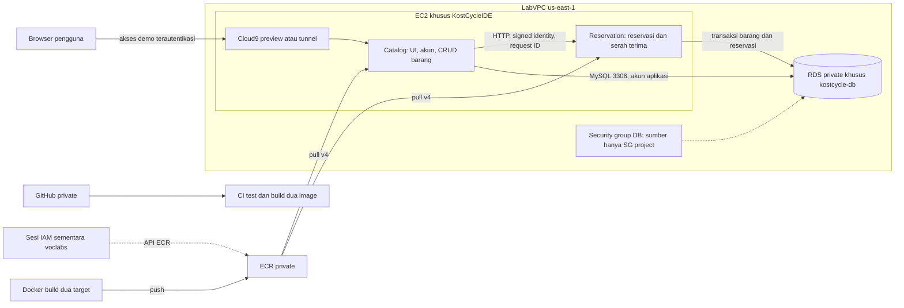

# KostCycle

Platform jual dan berbagi barang antarpenghuni kos. Barang lama, cerita baru.

**Penyusun:** Stella Florencia Doulim · NIU 542739
**Jalur:** Track B (EC2 + Docker + ECR), ditambah RDS MySQL dari Track A.

[Demo KostCycle melalui Cloud9](https://53d11ecee3fb4bd1b939f5dd1612dd54.vfs.cloud9.us-east-1.amazonaws.com/) memerlukan sesi AWS pemilik lingkungan. Buka sebagai tab sendiri, karena proteksi frame mencegah tampilan di dalam iframe IDE. EC2 berhenti otomatis setelah 30 menit Cloud9 tidak aktif.

[CI berhasil untuk commit 3c5b2c9](https://github.com/StellaFD/kostcycle/actions/runs/45451460895): tes aplikasi dan build dua image.

## Fitur

- Katalog barang gratis/dijual; pencarian, kategori, kondisi, urutan harga.
- Akun, autentikasi sesi, kata sandi di-hash, otorisasi pemilik dan proteksi CSRF.
- CRUD barang, dengan validasi harga gratis/dijual.
- Reservasi, pembatalan, dan konfirmasi pengambilan oleh pemilik.
- Pencegahan reservasi ganda memakai transaksi dan unique active_item_id.
- Halaman Barang Saya dan Reservasi; data contoh untuk demonstrasi.
- Tampilan responsif; ilustrasi SVG kategori (bukan foto barang asli).

## Dua layanan

| Layanan | Tanggung jawab | Akses |
|---|---|---|
| catalog | UI, akun, CRUD barang, proxy ke reservation | Host port 8080 melalui preview Cloud9 |
| reservation | Reservasi dan transaksi status barang | Jaringan internal Docker, tanpa published port |

Versi `v4` memisahkan kode layanan ke `app/catalog.py` dan `app/reservation.py`. Setiap layanan mempunyai entrypoint dan target Docker sendiri. Image reservation tidak membawa kode katalog atau tampilan web. Keduanya dapat dibangun dan diperbarui secara terpisah melalui Compose.

Kedua image `v4` sudah dibangun dan di-push ke ECR private pada 25 November 2026:

| Repository ECR | Tag |
|---|---|
| kostcycle-catalog | `v4` |
| kostcycle-reservation | `v4` |

Rancangan ini memakai dua layanan yang berkomunikasi melalui HTTP, dengan satu RDS MySQL bersama. Database bersama dipilih agar perubahan status barang dan reservasi tetap dalam satu transaksi. Konsekuensinya, pemisahan data belum penuh: kedua layanan masih bergantung pada skema yang sama, dan gangguan RDS memengaruhi keduanya. Satu EC2 juga masih menjadi titik kegagalan bersama.

Komunikasi dan pemantauan layanan:

- Identitas internal ditandatangani, berlaku 30 detik, dan terikat pada metode, path, serta isi JSON. Cookie pengguna tidak diteruskan ke reservation.
- `X-Request-ID` menghubungkan log kedua layanan; log mencatat layanan, metode, path, status, dan durasi tanpa isi request atau token.
- `/live` memeriksa proses; `/health` memeriksa koneksi database.
- Timeout HTTP internal dan uji gangguan menunjukkan katalog tetap dapat digunakan saat reservation terputus, selama database tersedia.
- Workflow GitHub Actions menguji kode dan membangun dua target image. Deployment AWS dijalankan secara manual setelah pengujian berhasil.

## Lingkungan proyek

Deployment menggunakan akun AWS Academy pada region `us-east-1`. EC2 dibuat melalui lingkungan Cloud9 `KostCycleIDE`; database berada pada RDS `kostcycle-db`. Keduanya berada di akun lab yang sama. Lingkungan latihan kafe tetap terpisah.

| Bagian | Teknologi | Lokasi |
|---|---|---|
| Frontend | HTML, CSS, JavaScript | Berkas disajikan oleh catalog di EC2; JavaScript berjalan di browser |
| Backend katalog | Python, Flask, Gunicorn | Container catalog di EC2 lab |
| Backend reservasi | Python, Flask, Gunicorn | Container reservation di EC2 lab |
| Data | MySQL 8.4.11 | RDS private di lab |
| Image | Dua image Docker versi v4 | Dua repository ECR private di lab |
| Source dan pemeriksaan kode | Git, GitHub Actions | Repository private GitHub |

Koneksi aplikasi dan data pada deployment menggunakan AWS lab. SQLite serta proses lokal hanya digunakan untuk pengembangan dan pengujian.

### Port container

Catalog menggunakan pemetaan host `8080` ke port `8000` di dalam container. Reservation mendengarkan pada port `8000` di jaringan Docker tanpa pemetaan ke port host. Catalog mengaksesnya melalui alamat `http://kostcycle-reservation:8000` pada deployment ECR, atau `http://reservation:8000` pada Compose.

Tidak adanya published port pada reservation tidak menghalangi komunikasi antarlayanan. Akses browser masuk melalui catalog, lalu permintaan reservasi diteruskan melalui jaringan Docker. Perintah `EXPOSE 8000` pada Dockerfile mencatat port aplikasi; pemetaan ke host ditentukan saat container dijalankan.

## Menjalankan lokal tanpa Docker

Python 3.12 diperlukan. Dari direktori proyek:

```powershell
python -m venv .venv
.\.venv\Scripts\python.exe -m pip install -r requirements.txt
.\.venv\Scripts\python.exe run_local.py
```

Buka http://127.0.0.1:8001. Dua proses berjalan di port 8001 (catalog) dan 8002 (reservation). SQLite lokal digunakan hanya untuk pengembangan/pengujian. Tekan Ctrl+C untuk menghentikan keduanya.

Data contoh lokal dibuat jika `SEED_DEMO=1` (default mode lokal). Akun Alya dan Bima tersedia melalui tombol akun demo. Email: `alya@demo.kostcycle` / `bima@demo.kostcycle`, kata sandi contoh: `KostCycleDemo!`. Jangan gunakan kredensial contoh atau data pribadi untuk deployment produksi.

## Pengujian

Pada 25 November 2026, 24 tes lokal lulus, termasuk satu tes integrasi yang menjalankan 17 pemeriksaan HTTP antara dua server dengan SQLite. Versi v4 juga melewati 17 pemeriksaan HTTP pada MySQL RDS baru. Uji AWS menghentikan container reservation: katalog dan health tetap 200, endpoint reservasi 503. Setelah container dinyalakan lagi, endpoint reservasi kembali 200. Log kedua layanan memiliki request ID `aws-microservices-v4` yang sama.

```powershell
.\.venv\Scripts\python.exe -m pytest -q
node --check app/static/app.js
```

Pengujian mencakup CRUD, otorisasi, CSRF, validasi, reservasi sendiri/ganda, pembatalan, penyelesaian, riwayat, dan persaingan dua pemesan. Pengujian SQLite tidak menggantikan verifikasi koneksi dan transaksi MySQL di AWS.

## Docker dan MySQL/RDS

1. Salin `.env.example` ke `.env` dan isi endpoint MySQL, akun database khusus aplikasi, serta dua secret acak.
2. Buat database `kostcycle` di RDS yang diizinkan lab; jangan mengubah database latihan `COFFEE`.
3. Bangun dengan `docker compose build`, lakukan inisialisasi database sekali, lalu `docker compose up -d`.
4. Periksa `docker compose ps` dan `/health`; hasil harus menyebut `mysql` pada AWS.

`compose.yaml` menggunakan `127.0.0.1:8080` secara default. Siapkan `.env`, lalu jalankan inisialisasi sekali memakai `docker compose run --rm catalog python -m app.bootstrap` sebelum `docker compose up -d`. Pada database baru, akun inisialisasi perlu hak pembuatan tabel; akun runtime cukup SELECT, INSERT, UPDATE, DELETE. Jangan menjalankan inisialisasi pada database kafe.

Untuk EC2 khusus project, script deployment memeriksa marker `/etc/kostcycle-project`. Buat marker hanya setelah identitas instance diverifikasi. Akses internet langsung memerlukan pengaturan bind dan security group terpisah; marker tidak memberikan izin jaringan. Gunakan tunnel atau preview Cloud9 yang terautentikasi untuk demo pribadi.

Gunakan akun DB khusus dengan hak hanya pada `kostcycle.*`. `.env`, kunci SSH, token AWS, dan password tidak boleh masuk Git/ECR. Container berjalan sebagai user non-root. Konfigurasi keamanan dan keterbatasan demo dicatat pada bagian IAM dan jaringan.

### Deployment lab dari ECR

Pada EC2 Linux dengan Docker, konfigurasi `.env` serta kredensial AWS **sementara** dari lab. Gunakan IAM role yang sesuai jika tersedia; EC2 proyek tidak memiliki instance profile; tidak ada IAM role aplikasi baru yang dibuat. Push/pull menggunakan kredensial sementara yang dikelola Cloud9 untuk sesi `voclabs`. Aplikasi yang sudah berjalan tidak memerlukan kredensial AWS.

```bash
bash scripts/publish-images.sh v5  # Pilih tag baru; v4 sudah immutable di ECR.
bash scripts/deploy-ecr.sh v5
```

Script deployment menggunakan `127.0.0.1:8080` secara default. Pada deployment Cloud9 yang diuji, catalog terikat pada host port 8080 agar preview dapat meneruskan request; security group tetap tidak membuka 8080 dari internet. Script menjalankan catalog di port **8080**, reservation hanya di jaringan Docker, dan menyimpan container sebelumnya dalam keadaan berhenti untuk rollback. Script membersihkan token login Docker setelah selesai. Perubahan security group untuk akses demo dilakukan terpisah; RDS tetap private. Mode Compose tetap tersedia untuk lingkungan yang memiliki Docker Compose.

## Entitas CRUD utama: barang

Entitas utama adalah barang, disimpan pada tabel `items` dan diakses melalui API `/api/barang`. Tabel `users` menyimpan akun, sedangkan `reservations` menyimpan pemesanan dan riwayat serah terima.

| Field | Tipe | Aturan |
|---|---|---|
| id | integer, primary key | Identitas unik barang |
| owner_id | integer, foreign key users.id | Pemilik barang; ditentukan dari sesi login |
| name | varchar(100) | Wajib diisi |
| description | text | Wajib, maksimal 1.500 karakter melalui API |
| category | varchar(30) | Furnitur, Elektronik, Dapur, Buku, Fashion, Lainnya |
| condition | varchar(30) | Seperti baru, Baik, Layak pakai |
| offer_type | varchar(10) | free atau sale |
| price | integer | free = 0; sale > 0; maksimum Rp100.000.000 |
| location | varchar(100) | Area pengambilan umum |
| status | varchar(20) | available → reserved → completed; pembatalan mengembalikan available |
| created_at | datetime | Waktu pencatatan |

Pemilik hanya dapat mengubah barang yang masih tersedia. Barang dengan riwayat reservasi tidak dapat dihapus agar riwayat tetap konsisten. Transaksi dan unique active_item_id mencegah dua reservasi aktif untuk satu barang.

## API

| Metode | Endpoint | Akses |
|---|---|---|
| GET | `/health` | Status layanan/database |
| GET | `/api/stats` | Statistik katalog |
| GET | `/api/barang` | Publik; filter q/category/offer_type/status/sort |
| GET | `/api/barang/{id}` | Publik |
| POST | `/api/barang` | Login + CSRF |
| PUT | `/api/barang/{id}` | Pemilik, status tersedia + CSRF |
| DELETE | `/api/barang/{id}` | Pemilik, tersedia, tanpa riwayat reservasi + CSRF |
| GET | `/api/auth/me` | Akun aktif dan CSRF token |
| POST | `/api/auth/login` | Login |
| POST | `/api/auth/register` | Registrasi |
| POST | `/api/auth/logout` | Login + CSRF |
| GET | `/api/reservasi` | Reservasi milik pengguna/untuk barang pengguna |
| POST | `/api/reservasi` | Login + CSRF; item_id, note |
| POST | `/api/reservasi/{id}/cancel` | Pemesan/pemilik + CSRF |
| POST | `/api/reservasi/{id}/complete` | Pemilik + CSRF |

Reservasi diteruskan catalog ke layanan reservation melalui HTTP internal dan identitas bertanda tangan. Browser tidak mengakses port reservation secara langsung.

Contoh body barang:

```json
{"name":"Rak buku tiga tingkat","description":"Kokoh, ada bekas pemakaian ringan.","category":"Furnitur","condition":"Baik","offer_type":"sale","price":75000,"location":"Pogung, Sleman"}
```

## Ruang lingkup

KostCycle mencakup katalog barang, pengelolaan akun, reservasi, pembatalan, dan konfirmasi serah terima langsung. Data serta ilustrasi yang digunakan merupakan contoh. Transaksi pembayaran dan pengiriman berada di luar ruang lingkup proyek.

## Arsitektur

Arsitektur terdiri dari dua layanan pada EC2 dan satu RDS private. Image masing-masing layanan disimpan di ECR. CI membangun image untuk pemeriksaan; push ke ECR dan deployment dilakukan secara manual.



Cloud9 khusus: `53d11ecee3fb4bd1b939f5dd1612dd54`. EC2: `i-0cf5f5c917e9590d4`, Amazon Linux 2023, t3.small. Image disimpan di ECR, tidak membutuhkan laptop menyala. Tidak ada perubahan pada source aplikasi kafe atau Cloud9 MicroservicesIDE milik latihan awal.

### Alur request dan data

1. Browser meminta UI dan API barang ke catalog melalui port 8080 dan jalur akses demo yang dikonfigurasi.
2. Catalog membaca/menulis tabel barang pada database `kostcycle` di RDS melalui port 3306.
3. Untuk reservasi, catalog meneruskan permintaan HTTP ke reservation di jaringan Docker, menyertakan identitas pengguna yang ditandatangani serta X-Request-ID; cookie dan CSRF tetap diperiksa di catalog.
4. Reservation memperbarui status barang dan reservasi dalam satu transaksi MySQL. Hasil kembali melalui catalog ke browser.
5. ECR hanya terlibat saat distribusi image, bukan pada setiap request pengguna.

### IAM dan jaringan v4

| Bagian | Konfigurasi yang diperiksa |
|---|---|
| Akses API AWS | Sesi IAM sementara voclabs melalui Cloud9; kredensial tidak disimpan dalam image atau Git |
| EC2 role | Tidak ada instance profile pada EC2 project |
| EC2 | t3.small, Amazon Linux 2023, Public Subnet1 di LabVPC |
| SG EC2 | `sg-0e9c7adbd27b31617`; SSH dari rentang layanan Cloud9 saja; tidak ada inbound 8080 dari internet |
| Akses demo | HTTPS preview Cloud9 pada tab tersendiri, memerlukan sesi AWS yang berhak |
| Reservation | Tanpa port host; HTTP di jaringan Docker dengan identitas bertanda tangan |
| RDS | `kostcycle-db`, MySQL 8.4.11, db.t3.micro, 20 GB gp3, Single-AZ, tidak publik |
| SG RDS | `sg-0355f6b1b9a0ec3b7`; TCP 3306 hanya dari SG EC2 project |
| Akun runtime | kostcycle_app; SELECT, INSERT, UPDATE, DELETE pada kostcycle.*; tanpa hak DDL |
| Pengguna | Login sesi, CSRF di catalog, pemeriksaan kepemilikan dan status transaksi |

IAM AWS mengatur API AWS, akun MySQL mengatur database, dan otorisasi aplikasi mengatur tindakan pengguna. RDS demo ini belum memakai enkripsi penyimpanan dan backup otomatis; cadangan migrasi disimpan terpisah. Koneksi aplikasi ke MySQL belum dikonfigurasi untuk mewajibkan TLS. Cookie Secure belum diaktifkan untuk mendukung tes HTTP internal; browser demo memakai HTTPS melalui preview. Konfigurasi ini untuk data contoh, bukan layanan produksi.

### Inisialisasi RDS khusus

Buat instance dengan identifier `kostcycle-db`, username admin `kostcycleadmin`, dan database awal `kostcycle`. Script `scripts/initialize-rds.py` menolak endpoint lain serta database yang sudah mempunyai tabel. Jalankan script memakai image catalog, dengan direktori private dipasang sebagai `/state`, berisi file `db-admin-password` berizin 600. Mount script sebagai `/run/init.py`, set `PYTHONPATH=/app` dan `DB_HOST` ke endpoint RDS, lalu jalankan `python /run/init.py`. Optional mount `/run/backup.sql` hanya untuk dump KostCycle yang telah diperiksa.

Script membuat tabel/data demo jika tanpa dump, lalu membuat akun runtime terbatas dan menghasilkan `/state/app.env`. Salin file itu menjadi `.env` dengan izin 600. Password admin tidak dimasukkan ke `.env` runtime. Inisialisasi dilakukan satu kali; startup container tidak membuat tabel atau seed ulang. Jangan menjalankan script ini pada supplierdb latihan.

### Hasil deployment

Arsip proyek menyertakan folder `aws-evidence/v4`, berisi metadata EC2, dua image ECR, RDS, security group, status container, jumlah baris saat migrasi, 17 hasil tes HTTP, hasil uji gangguan, dan log request antarlayanan. Data SQL, password, cookie, token, kunci SSH, dan file .env tidak disertakan.

## Anggaran dan lab

Proyek menggunakan satu EC2 khusus dan satu RDS kecil, terpisah dari latihan kafe. Aktifkan compute hanya saat pengerjaan dan demo. Cloud9 disetel berhenti otomatis setelah 30 menit tidak aktif; ini perlu diperhatikan ketika demo. Deployment menggunakan EC2, ECR, dan RDS tanpa penambahan ALB, NAT Gateway, atau ECS. Budget terakhir yang diamati saat sesi dimulai pada 25 November 2026: US$3,80 terpakai dari US$40; angka dapat terlambat diperbarui. Periksa kondisi aktual sebelum deployment dan akhiri sesi sesuai petunjuk lab setelah selesai. Penyimpanan tetap dapat menimbulkan biaya meskipun compute berhenti.

Referensi: [ECR push image](https://docs.aws.amazon.com/AmazonECR/latest/userguide/docker-push-ecr-image.html), [ECR IAM](https://docs.aws.amazon.com/AmazonECR/latest/userguide/image-push-iam.html), [RDS biaya](https://docs.aws.amazon.com/AmazonRDS/latest/UserGuide/USER_OnDemandDBInstances.html).
