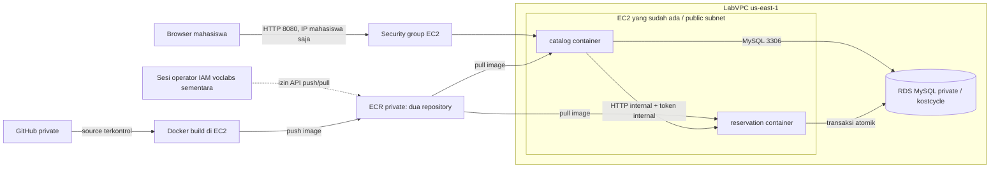

# KostCycle

Platform jual dan berbagi barang antarpenghuni kos. Barang lama, cerita baru.

**Pemilik proyek:** Stella Florencia Doulim · NIU 542739  
**Jalur:** Track B (EC2 + Docker + ECR), dengan RDS MySQL sebagai penyimpanan.

## Fitur

- Katalog barang gratis/dijual; pencarian, kategori, kondisi, urutan harga.
- Akun, autentikasi sesi, kata sandi di-hash, otorisasi pemilik dan proteksi CSRF.
- CRUD barang, dengan validasi harga gratis/dijual.
- Reservasi, pembatalan, dan konfirmasi pengambilan oleh pemilik.
- Pencegahan reservasi ganda memakai transaksi dan unique active_item_id.
- Halaman Barang Saya dan Reservasi; data contoh untuk demonstrasi.
- Tampilan responsif; ilustrasi SVG kategori (bukan foto barang asli).

## Dua layanan

| Layanan | Tanggung jawab | Akses |
|---|---|---|
| catalog | UI, akun, CRUD barang, proxy ke reservation | Port publik aplikasi |
| reservation | Reservasi dan transaksi status barang | Jaringan internal Docker, tanpa published port |

Kedua layanan dibangun dari source/image dasar yang sama, dipilih dengan `SERVICE`. Image sudah disimpan pada dua repository ECR: `kostcycle-catalog` dan `kostcycle-reservation`. Versi `v3` di keduanya memiliki digest yang sama: `sha256:a75e8ea9abce8adae9996fee08b75c6244f26b05f7ffc272d1fde30c55a9832f`. Artinya, ini **satu image dasar yang digunakan oleh dua layanan**, bukan dua implementasi image yang berbeda. Minimum slide adalah membangun satu Docker image; dua image berbeda dan dua EC2 tidak disebut sebagai kewajiban.

Keduanya menggunakan satu database MySQL **bersama** untuk menjaga transaksi barang/reservasi atomik pada skala tugas. Ini merupakan tradeoff: layanan belum independen pada tingkat data, bukan pola database-per-service. Pemisahan database dan saga menjadi pengembangan berikutnya.

## Pemetaan kriteria tugas Week 12

Pemetaan ini mengikuti slide tugas kuliah, bukan seluruh rangkaian proyek kafe pada README bawaan AWS Academy. Bukti implementasi di bawah diverifikasi pada 24 November 2026; status server dapat berubah setelah sesi lab berakhir.

| Perintah pada slide | Pemenuhan KostCycle | Bukti |
|---|---|---|
| Track B: EC2 + Docker + ECR | Dua container dijalankan pada satu EC2 lab; image di-push dan di-pull dari ECR private | Script deployment, status container, metadata image ECR |
| Minimum: two planned services | `catalog` dan `reservation` dirancang dan keduanya sudah berjalan | Tabel dua layanan; HTTP internal dari catalog ke reservation |
| Minimum: build one Docker image | Satu image dasar dibangun, kemudian diberi tag pada dua repository | Dockerfile; ECR `v3` dengan digest yang sama |
| Choose a use case | Jual/berikan barang antarpenghuni kos; reservasi pengambilan langsung | Fitur, data contoh, dan UI KostCycle |
| Architecture diagram: request/data flow, IAM, network | Diagram dan penjelasan jaringan/IAM pada bagian arsitektur | Diagram Mermaid di README |
| 1 entity | Entitas CRUD utama `barang` / tabel `items` | Struktur entitas di bawah; `app/models.py` |
| CRUD endpoints | POST, GET daftar/detail, PUT, DELETE barang | Tabel API; `app/main.py`; pengujian CRUD |
| AWS Learner Lab | Deployment memakai akun lab, region us-east-1 | EC2/ECR/RDS pada sesi lab |
| Git repo + README | Repository private dengan source, Dockerfile, skrip, dan petunjuk | https://github.com/StellaFD/kostcycle |
| Provision basic resources and test connectivity | EC2/RDS yang tersedia digunakan kembali; Docker, jaringan container, database aplikasi, dan ECR dikonfigurasi | Health MySQL; 17 pemeriksaan HTTP; uji browser |

**Batas pemenuhan:** EC2 dan instance RDS digunakan kembali, bukan dibuat dari nol. Konfigurasi aplikasi, Docker, ECR, dan database `kostcycle` dilakukan untuk proyek ini. Slide tidak secara eksplisit mewajibkan EC2 baru, dua EC2, Kubernetes, ECS, load balancer, atau pipeline CI/CD. RDS adalah tambahan penyimpanan, bukan pengganti EC2/Docker/ECR. Laporan PDF dan susunan screenshot pengumpulan belum dibuat; ZIP source belum merupakan laporan akhir.

## Menjalankan lokal tanpa Docker

Python 3.12 diperlukan. Dari direktori proyek:

```powershell
python -m venv .venv
.\.venv\Scripts\python.exe -m pip install -r requirements.txt
.\.venv\Scripts\python.exe run_local.py
```

Buka http://127.0.0.1:8001. Dua proses berjalan di port 8001 (catalog) dan 8002 (reservation). SQLite lokal digunakan hanya untuk pengembangan/pengujian. Tekan Ctrl+C untuk menghentikan keduanya.

Data contoh lokal dibuat jika `SEED_DEMO=1` (default mode lokal). Akun Alya dan Bima tersedia melalui tombol akun demo. Email: `alya@demo.kostcycle` / `bima@demo.kostcycle`, kata sandi contoh: `KostCycleDemo!`. Jangan gunakan kredensial contoh atau data pribadi untuk deployment produksi.

## Pengujian

```powershell
.\.venv\Scripts\python.exe -m pytest -q
node --check app/static/app.js
```

Pengujian mencakup CRUD, otorisasi, CSRF, validasi, reservasi sendiri/ganda, pembatalan, penyelesaian, riwayat, dan persaingan dua pemesan. Pengujian SQLite tidak menggantikan verifikasi koneksi dan transaksi MySQL di AWS.

## Docker dan MySQL/RDS

1. Salin `.env.example` ke `.env` dan isi endpoint MySQL, akun database khusus aplikasi, serta dua secret acak.
2. Buat database `kostcycle` di RDS yang diizinkan lab; jangan mengubah database latihan `COFFEE`.
3. Jalankan `docker compose up -d --build`.
4. Periksa `docker compose ps` dan `/health`; hasil harus menyebut `mysql` pada AWS.

`compose.yaml` mempublikasikan catalog pada port 80. Jika server sudah memiliki aplikasi di port 80, gunakan override port atau perintah `docker run` pada port berbeda; jangan menghentikan aplikasi yang tidak dimiliki proyek.

Gunakan akun DB khusus dengan hak hanya pada `kostcycle.*`. `.env`, kunci SSH, token AWS, dan password tidak boleh masuk Git/ECR. Container berjalan sebagai user non-root. Untuk produksi, aktifkan HTTPS, `COOKIE_SECURE=1`, nonaktifkan seed demo, gunakan pengelolaan secret dan pembatasan percobaan login. Demo lab HTTP hanya untuk data contoh.

### Deployment lab dari ECR

Pada EC2 Linux dengan Docker, konfigurasi `.env` serta kredensial AWS **sementara** dari lab. Gunakan IAM role yang sesuai jika tersedia; jangan memasang role EMR untuk aplikasi ini. Pada sesi lab yang diperiksa, EC2 tidak memiliki instance profile dan `LabRole` tidak ditemukan, sehingga push/pull dilakukan operator melalui sesi `voclabs` sementara.

```bash
bash scripts/publish-images.sh v3  # Gunakan versi baru; tag ECR immutable.
bash scripts/deploy-ecr.sh v3
```

Script deployment menjalankan catalog di port **8080**, reservation hanya di jaringan Docker, dan menyimpan container sebelumnya dalam keadaan berhenti untuk rollback. Script membersihkan token login Docker setelah selesai. Perubahan security group untuk akses demo dilakukan terpisah; RDS tetap private. Mode Compose tetap tersedia untuk lingkungan yang memiliki Docker Compose.

## Entitas CRUD utama: barang

Nama API `barang` dipetakan ke tabel `items`. Satu entitas ini memenuhi bagian desain entitas dan CRUD. Tabel `users` serta `reservations` mendukung akun dan alur reservasi tambahan.

| Field | Tipe | Aturan |
|---|---|---|
| id | integer, primary key | Identitas unik barang |
| owner_id | integer, foreign key users.id | Pemilik barang; ditentukan dari sesi login |
| name | varchar(100) | Wajib diisi |
| description | text | Wajib, maksimal 1.500 karakter melalui API |
| category | varchar(30) | Furnitur, Elektronik, Dapur, Buku, Fashion, Lainnya |
| condition | varchar(30) | Seperti baru, Baik, Layak pakai |
| offer_type | varchar(10) | free atau sale |
| price | integer | free = 0; sale > 0; maksimum Rp100.000.000 |
| location | varchar(100) | Area pengambilan umum |
| status | varchar(20) | available → reserved → completed; pembatalan mengembalikan available |
| created_at | datetime | Waktu pencatatan |

Pemilik hanya dapat mengubah barang yang masih tersedia. Barang dengan riwayat reservasi tidak dapat dihapus agar riwayat tetap konsisten. Transaksi dan unique active_item_id mencegah dua reservasi aktif untuk satu barang.

## API

| Metode | Endpoint | Akses |
|---|---|---|
| GET | `/health` | Status layanan/database |
| GET | `/api/stats` | Statistik katalog |
| GET | `/api/barang` | Publik; filter q/category/offer_type/status/sort |
| GET | `/api/barang/{id}` | Publik |
| POST | `/api/barang` | Login + CSRF |
| PUT | `/api/barang/{id}` | Pemilik, status tersedia + CSRF |
| DELETE | `/api/barang/{id}` | Pemilik, tersedia, tanpa riwayat reservasi + CSRF |
| GET | `/api/auth/me` | Akun aktif dan CSRF token |
| POST | `/api/auth/login` | Login |
| POST | `/api/auth/register` | Registrasi |
| POST | `/api/auth/logout` | Login + CSRF |
| GET | `/api/reservasi` | Reservasi milik pengguna/untuk barang pengguna |
| POST | `/api/reservasi` | Login + CSRF; item_id, note |
| POST | `/api/reservasi/{id}/cancel` | Pemesan/pemilik + CSRF |
| POST | `/api/reservasi/{id}/complete` | Pemilik + CSRF |

Reservasi diteruskan catalog ke layanan reservation melalui HTTP internal dan token internal. Browser tidak mengakses port reservation secara langsung.

Contoh body barang:

```json
{"name":"Rak buku tiga tingkat","description":"Kokoh, ada bekas pemakaian ringan.","category":"Furnitur","condition":"Baik","offer_type":"sale","price":75000,"location":"Pogung, Sleman"}
```

## Lingkup Week 12

Desain dua layanan, satu entitas CRUD utama (`barang`), Docker image, EC2, ECR, koneksi database, dan README. Fitur reservasi menjadi demonstrasi tambahan. Laporan akhir dibuat setelah implementasi AWS terverifikasi. Belum ada payment gateway, chat, unggah foto, pengiriman, atau transaksi uang nyata.

## Arsitektur implementasi



Database `COFFEE` dan aplikasi latihan bawaan pada port 80 dipertahankan. KostCycle memakai database `kostcycle` dan port 8080. EC2 Cloud9 yang sudah berhenti tidak dijalankan untuk deployment ini. Link aplikasi menggunakan IP publik EC2; IP dan izin sumber perlu diperiksa lagi setelah sesi lab atau jaringan laptop berubah.

### Alur request dan data

1. Browser meminta UI dan API barang ke catalog melalui port 8080 EC2.
2. Catalog membaca/menulis tabel barang pada database `kostcycle` di RDS melalui port 3306.
3. Untuk reservasi, catalog meneruskan permintaan HTTP ke reservation di jaringan Docker, menyertakan cookie sesi, CSRF token, dan token internal.
4. Reservation memperbarui status barang dan reservasi dalam satu transaksi MySQL. Hasil kembali melalui catalog ke browser.
5. ECR hanya terlibat saat distribusi image, bukan pada setiap request pengguna.

### IAM dan batas jaringan yang diterapkan

| Bagian | Konfigurasi/akses |
|---|---|
| Operator AWS | Sesi sementara `voclabs` dari Learner Lab untuk operasi ECR dan konfigurasi; kredensial tidak dimasukkan ke source/image |
| EC2 instance role | Tidak ada instance profile pada EC2 yang dipakai; tidak mengklaim memakai LabRole atau role EC2 untuk pull |
| EC2 jaringan | LabVPC, public subnet yang sudah tersedia; akses KostCycle TCP 8080 dibatasi ke IP jaringan mahasiswa saat konfigurasi |
| Layanan reservation | Tidak memiliki published host port; diakses catalog melalui jaringan Docker dan token internal |
| RDS | MySQL db.t3.micro, 20 GB, Single-AZ, PubliclyAccessible=false; koneksi dari EC2 ke port 3306 berhasil diuji |
| Akun database | `kostcycle_app` dibatasi pada database `kostcycle`; berbeda dari akun admin lab |
| Otorisasi pengguna | Sesi login, CSRF, dan pemeriksaan kepemilikan pada perubahan barang/reservasi |

IAM AWS mengatur akses API AWS; akun MySQL mengatur akses database; otorisasi aplikasi mengatur hak pengguna KostCycle. Ketiganya berbeda. Demo menggunakan HTTP untuk data contoh, belum deployment produksi dengan HTTPS.

## Anggaran dan lab

Gunakan resource yang sudah ada jika cocok. Jangan membuat RDS/EC2 duplikat tanpa estimasi. Hindari ALB/NAT Gateway/ECS untuk deployment minimum ini. Budget terakhir yang diamati pada 24 November 2026: US$3,80 terpakai dari US$40; angka dapat terlambat diperbarui. Periksa kondisi aktual sebelum deployment dan akhiri sesi sesuai petunjuk lab setelah selesai. Penyimpanan tetap dapat menimbulkan biaya meskipun compute berhenti.

Referensi: [ECR push image](https://docs.aws.amazon.com/AmazonECR/latest/userguide/docker-push-ecr-image.html), [ECR IAM](https://docs.aws.amazon.com/AmazonECR/latest/userguide/image-push-iam.html), [RDS biaya](https://docs.aws.amazon.com/AmazonRDS/latest/UserGuide/USER_OnDemandDBInstances.html).
